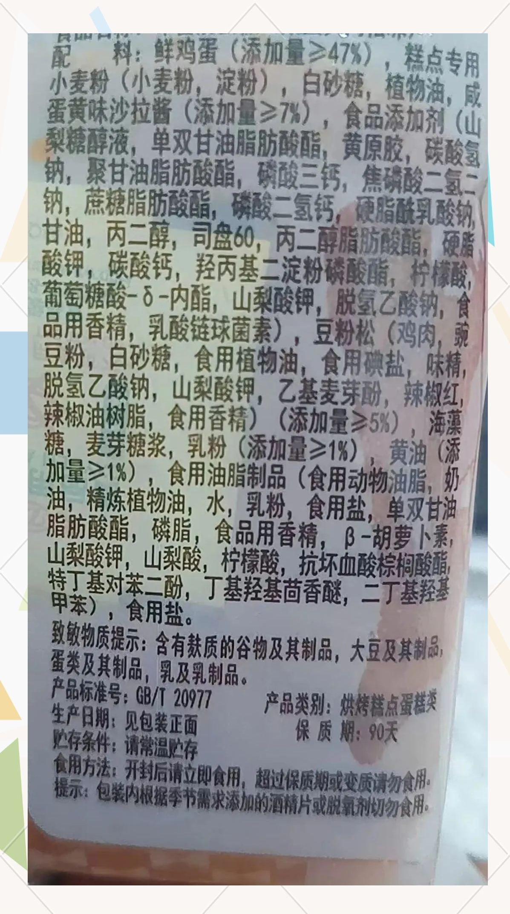

# IngredientLens — Food Label OCR & Additive Risk Analysis API

> A production FastAPI service that reads food-ingredient labels with OCR and turns messy, real-world text into structured, personalized safety analysis. Built end-to-end by one engineer.

`FastAPI` · `Python` · `SQLite` · `Aho-Corasick` · `OCR Integration` · `Pydantic` · `pytest`

---

## The problem

Food labels are photographed in the wild: low light, curved packaging, blurred text. OCR output is noisy — characters are misread (`非甲酸钠` for `苯甲酸钠`), ingredient names run together without separators, and one product can contain dozens of additives. A naive keyword search produces both false positives (`柠檬酸` matching inside `柠檬酸钠`) and silent misses.

This service solves that end to end: OCR → text cleanup → ingredient extraction → per-user risk analysis → structured JSON, with a feedback loop that lets an admin correct OCR errors so the same mistake never recurs.

## What it does

- **Dual OCR backends** behind one interface (`ali` official SDK / `tysbgpu` marketplace AppCode), selected by config. Sync SDK work is offloaded to a thread executor so the async API stays responsive. Returns text **plus confidence metadata** (`avg_confidence`, `low_confidence_words`) so downstream code can decide when to distrust a read.
- **Ingredient extraction from noisy text.** A hand-written **Aho-Corasick multi-pattern matcher** (trie + failure links, greedy longest non-overlapping match) scans the whole label in one pass — `配料：柠檬酸钠咖啡因` correctly yields two ingredients, not a false `柠檬酸`.
- **A 560+ entry knowledge base** with aliases, E-numbers, OCR correction rules, safety levels, risk notes and tags, stored in YAML/CSV and synced into SQLite on startup, then loaded into memory with the matcher rebuilt on every admin edit.
- **Unknown-ingredient handling.** Unrecognized tokens are collected per user and ranked by frequency; an admin reviews the top candidates, and `SequenceMatcher`-based fuzzy suggestions propose likely canonical names. Confirmed mappings become `ocr_corrections` — the system learns from its own failures.
- **Personalized risk analysis.** A user profile (allergens, watched/avoided categories, conditions such as PKU or "children") drives layered output: allergens, additives, base ingredients, composites, user-focus items, plus warnings, coverage rate and a confidence score.
- **Admin CMS** with token auth (`X-Admin-Token`): ingredient CRUD, search/pagination, OCR-correction management, unknown-candidate review, YAML/CSV re-import and YAML export.
- **Production hygiene:** CORS allow-list, structured HTTP errors, temp-file cleanup in `finally`, env-based secrets with `.env.example`, health/index endpoints, and a 3-file pytest suite (362 lines) including a regression case built from a real noisy OCR capture.

## Architecture

```
Client (App / Web)
      │  POST /api/analyze  (image_url)  or  /api/analyze-text (text)
      ▼
FastAPI  ── validation, CORS, auth on admin routes
      │
      ├─ OCRService ── AliOCR (async SDK)  |  TYSBGPU OCR (thread executor)
      │                    └── text + confidence metadata
      │
      ▼
AnalysisService
      ├─ ingredient-section extraction (regex, noise filtering)
      ├─ IngredientMatcher (Aho-Corasick, one-pass longest match)
      ├─ alias / E-number / OCR-correction resolution
      ├─ fuzzy suggestions for unknowns (SequenceMatcher)
      └─ safety scoring + personalized profile rules
      │
      ▼
IngredientStore (SQLite)  ←→  YAML/CSV seed  ←→  Admin CMS (token auth)
      │
      └─ scan history + ocr_corrections → feedback loop
```

## Example

### Real production call — noisy photographed label

The interesting case is not a clean happy path. This is an unedited response from a real call on a photographed cake label, where OCR output is messy and the knowledge base does not know every token.



```bash
curl -X POST http://localhost:8000/api/analyze \
  -F 'image_url=https://pic.rmb.bdstatic.com/bjh/news/1398e73015a61cf69d9b34c5fadc4e2f.png' \
  -F 'user_profile={"allergens":[],"watch_categories":[],"conditions":[]}'
```

Response (annotated excerpt — [full unabridged JSON](examples/response-full.json)):

```json
{
  "code": 1,
  "message": "success",
  "data": {
    "ocr_meta": { "provider": "ali", "avg_confidence": 1, "low_confidence_words": [] },
    "analysis_result": {
      "ingredient_section": "梨糖醇液，单双甘油脂肪酸酯，黄原胶，碳酸钠，1聚甘油脂肪酸酯，磷酸三钙 ...",
      "matched_ingredients": [
        "单双甘油脂肪酸酯", "黄原胶", "碳酸钠", "聚甘油脂肪酸酯", "磷酸三钙",
        "... 33 matched in total"
      ],
      "unknown_ingredients": [
        "梨糖醇液", "二氢钙硬脂酰钠", "硬脂酸钾", "羟丙基二酯", "品用香精",
        "豆粉松(", "))(添加量≥5%)海藻采糖加", "... 13 surfaced in total"
      ],
      "coverage": {
        "matched_count": 33,
        "unknown_count": 13,
        "total_candidates": 46,
        "coverage_rate": 0.72,
        "database_size": 561
      },
      "confidence": 0.56,
      "ingredient_suggestions": [
        { "unknown": "梨糖醇液", "candidates": ["山梨醇液", "D-山梨糖醇"] },
        { "unknown": "硬脂酸钾", "candidates": ["硬脂酸镁"] },
        { "unknown": "品用香精", "candidates": ["食用香精"] },
        { "unknown": "食用碘盐", "candidates": ["氯化钠"] },
        { "unknown": "添奶油", "candidates": ["奶油"] }
      ],
      "warnings": [
        "ℹ️ 提示: 山梨酸钾 - 防腐剂，建议适量摄入",
        "💡 「梨糖醇液」未收录，您是否指: 山梨醇液、D-山梨糖醇？"
      ]
    }
  }
}
```

What this shows: 46 candidates → 33 matched, 13 **surfaced rather than swallowed**, 5 fuzzy suggestions, and an honest `confidence: 0.56` / `coverage_rate: 0.72` instead of a guessed-certain verdict. Every warning traces back to a knowledge-base entry. See [`examples/API_EXAMPLE.md`](examples/API_EXAMPLE.md) for the full annotated walkthrough.

### Text-only quick example

No cloud credentials needed — `POST /api/analyze-text` runs the same analysis pipeline offline:

```bash
curl -X POST http://localhost:8000/api/analyze-text \
  -F 'text_input=配料：水、小麦粉、苯甲酸钠、阿斯巴甜(含苯丙氨酸)、安赛蜜' \
  -F 'user_profile={"allergens":["花生"],"watch_categories":["甜味剂"],"conditions":["苯丙酮尿症"]}'
```

Response (abridged):

```json
{
  "code": 1,
  "message": "success",
  "data": {
    "analysis_result": {
      "confidence": 0.85,
      "coverage": {"matched_count": 5, "unknown_count": 0, "coverage_rate": 1.0},
      "matched_ingredients": ["水", "小麦粉", "苯甲酸钠", "阿斯巴甜", "安赛蜜"],
      "needs_attention": ["苯甲酸钠", "阿斯巴甜", "安赛蜜"],
      "personal_warnings": ["Allergen alert ...", "Ingredients you follow ..."],
      "by_type": {"additives": [], "base_ingredients": [], "user_focus": []},
      "ingredient_suggestions": []
    }
  }
}
```

## Run locally

```bash
pip install -r requirements.txt
cp .env.example .env          # add OCR credentials (or use text-only endpoint)
python scripts/build_seed_data.py
python scripts/init_db.py --force
python run.py                 # http://localhost:8000  ·  docs at /docs
pytest tests/ -v
```

Two endpoints work **without any cloud credentials**: `POST /api/analyze-text` and `GET /api/health` — so the core analysis pipeline can be reviewed offline.

## Tech notes / tradeoffs

- **Why Aho-Corasick instead of regex or repeated `str.find`?** One pass over the label regardless of dictionary size, and deterministic longest-match resolution avoids `柠檬酸` / `柠檬酸钠` false positives. The matcher is ~100 lines with no external dependency.
- **Why SQLite + in-memory load?** The dictionary is read-heavy and small; rebuilding the trie on admin edits gives instant consistency without a query per token.
- **Why confidence metadata from OCR?** Low-confidence words can be routed to the correction queue instead of silently producing a wrong risk verdict — critical in a health-adjacent product.
- **Honest scope:** this is a deterministic rules + fuzzy-matching pipeline, **not** an LLM application. The design deliberately avoids a black box for safety decisions; every warning is traceable to a rule and a knowledge-base entry.

---

*Built end-to-end by one engineer: API design, matching engine, OCR integration, data pipeline, admin tools and regression tests — iterated against real photographed labels.*
