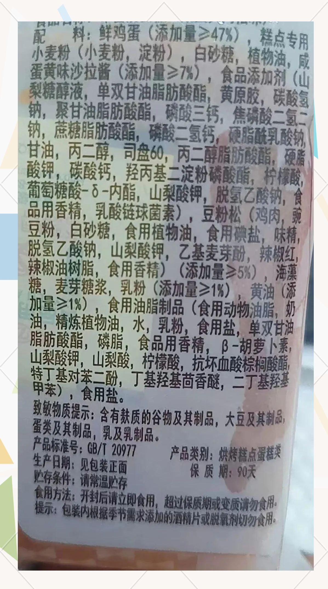

# API Example — Real Request & Response

This is an unedited response from a real production call on a photographed cake-label. It is included because the interesting part of this service is not the happy path — it is how it behaves when OCR output is messy and the knowledge base does not contain every token.

Source image used in this example:



## Request

```bash
curl -X POST http://localhost:8000/api/analyze \
  -F 'image_url=https://pic.rmb.bdstatic.com/bjh/news/1398e73015a61cf69d9b34c5fadc4e2f.png' \
  -F 'user_profile={"allergens":[],"watch_categories":[],"conditions":[]}'
```

The image is OCR'd by the configured provider, the ingredient section is isolated from surrounding marketing/storage text, and the extracted text is run through the matcher and risk engine.

## Response (annotated excerpt)

Full, unabridged response: [`response-full.json`](response-full.json)

```json
{
  "code": 1,
  "message": "success",
  "data": {
    "text_result": "配 料：鲜鸡蛋(添加量≥47%)，糕点专用小麦粉(小麦粉，淀粉)，白砂糖 ... 柠檬酸，葡萄糖酸-δ-内酯，山梨酸钾，脱氢乙酸钠 ... 致敏物质提示：含有麸质的谷物及其制品，大豆及其制品，蛋类及其制品，乳及乳制品 ...",
    "ocr_meta": {
      "provider": "ali",
      "avg_confidence": 1,
      "low_confidence_words": []
    },
    "analysis_result": {
      "ingredient_section": "梨糖醇液，单双甘油脂肪酸酯，黄原胶，碳酸钠，1聚甘油脂肪酸酯，磷酸三钙 ...",
      "matched_ingredients": [
        "单双甘油脂肪酸酯", "黄原胶", "碳酸钠", "聚甘油脂肪酸酯", "磷酸三钙",
        "磷酸二氢钠", "蔗糖脂肪酸酯", "磷酸", "乳酸", "甘油", "丙二醇", "司盘60",
        "丙二醇脂肪酸酯", "碳酸钙", "淀粉", "柠檬酸", "葡萄糖酸-δ-内酯",
        "山梨酸钾", "脱氢乙酸钠", "乳酸链球菌素", "鸡肉", "白砂糖",
        "食用植物油", "味精", "辣椒红", "辣椒", "食用香精", "麦芽糖浆",
        "乳粉", "黄油", "精炼植物油", "水", "食用盐"
      ],
      "unknown_ingredients": [
        "梨糖醇液", "二氢钙硬脂酰钠", "硬脂酸钾", "羟丙基二酯", "品用香精",
        "豆粉松(", "豆粉", "食用碘盐", "乙基麦芽酚", "油树脂",
        "))(添加量≥5%)海藻采糖加", "(添加量≥1%)由量≥1%)食用油脂制品(食用动物油脂", "添奶油"
      ],
      "coverage": {
        "matched_count": 33,
        "unknown_count": 13,
        "total_candidates": 46,
        "coverage_rate": 0.72,
        "database_size": 561
      },
      "confidence": 0.56,
      "ingredient_suggestions": [
        { "unknown": "梨糖醇液", "candidates": ["山梨醇液", "D-山梨糖醇"] },
        { "unknown": "硬脂酸钾", "candidates": ["硬脂酸镁"] },
        { "unknown": "品用香精", "candidates": ["食用香精"] },
        { "unknown": "食用碘盐", "candidates": ["氯化钠"] },
        { "unknown": "添奶油", "candidates": ["奶油"] }
      ],
      "warnings": [
        "ℹ️ 提示: 山梨酸钾 - 防腐剂，建议适量摄入",
        "   注意事项: 可能引起皮肤过敏, 过量可能影响消化系统",
        "💡 「梨糖醇液」未收录，您是否指: 山梨醇液、D-山梨糖醇？",
        "💡 「品用香精」未收录，您是否指: 食用香精？"
      ]
    }
  }
}
```

## What this response demonstrates

| Behaviour | Evidence in the response |
|---|---|
| **Ingredient-section isolation** | `ingredient_section` cuts the additive list out of a long label that also contains storage conditions, standard numbers and an allergen statement |
| **Longest-match disambiguation** | `柠檬酸` (citric acid) is matched correctly inside a list that also contains similar names; the hand-written Aho-Corasick matcher avoids the classic `柠檬酸` inside `柠檬酸钠` false positive |
| **Confidence is not faked** | `confidence: 0.56` and `coverage_rate: 0.72` are returned because 13 tokens were unrecognized — the service does not present a guessed result as certain |
| **Unknowns are surfaced, not swallowed** | All 13 unmatched tokens are listed, including OCR artifacts such as `豆粉松(` and `))(添加量≥5%)海藻采糖加` |
| **Fuzzy recovery path** | 5 of the 13 unknowns get candidate suggestions from `SequenceMatcher`; an admin can confirm a mapping, after which it becomes an `ocr_corrections` rule and the same OCR error never recurs |
| **Rule traceability** | Every warning is traceable to a knowledge-base entry — `山梨酸钾` carries category, E-number, `safe_limits: 最大使用量 2g/kg` and two concrete `potential_risks` |
| **Honest scope** | The engine is deterministic rules + fuzzy matching, not an LLM — chosen deliberately so a health-related warning can always be explained |

## Screenshots (optional, for the Upwork portfolio)

The JSON above is the strongest evidence — a client can read it. Screenshots add a visual layer. If you capture them from your running environment, redact before publishing:

| Shot | Where | Redact |
|---|---|---|
| Swagger API surface | `http://localhost:8000/docs` | nothing sensitive if only schema is shown |
| Admin CMS — ingredient list | `/admin` (token auth) | hide the `X-Admin-Token` value and any real user data |
| Analysis result in the App | the calling UI | hide any account name or personal profile fields |

Do **not** include a browser URL bar showing internal hostnames, `.env` values, or cloud credentials. Save into `docs/screenshots/` and embed in the README with Markdown image links.
